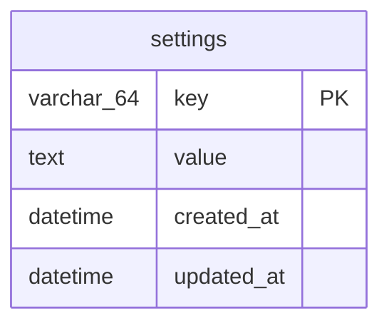

# Data Model

Tables and columns that exist now, with a Mermaid erDiagram of the current schema.

Source of truth: `server/prisma/schema.prisma`. Migrations: `server/prisma/migrations` (created with `prisma migrate dev`, never by hand).

## settings

Key and value pairs (blueprint 4.5). No relationships and no foreign keys.

| Column | Type | Notes |
| --- | --- | --- |
| key | VARCHAR(64), primary key | Setting name |
| value | TEXT, not null | Always a string. Numbers such as the rate are stored as text and read as Decimal where they are used (P5) |
| created_at | DATETIME(3) | Default now |
| updated_at | DATETIME(3) | Set by Prisma on every update |

Seeded defaults (`npm run db:seed`, idempotent; an existing value is never overwritten):

| key | value |
| --- | --- |
| perChildDailyRate | "25.00" (A-03) |
| currentSchoolYear | "2026-2027" (default; to be confirmed with the clients) |

## Sprint S1: centers, users, parent_profiles

Migration `20261106120950_auth_centers_users`.

| Table | Columns | Notes |
| --- | --- | --- |
| centers | id, name (unique), barangay, address, is_active, created_at, updated_at | 28 seeded from docs/seed-centers.md |
| users | id, role (ADMIN, TEACHER, PARENT), username (unique, stored lowercase), password_hash, full_name, mobile, center_id, status (ACTIVE, PENDING, DECLINED, DISABLED), must_change_password, failed_login_count, locked_until, token_version, last_login_at, created_at, updated_at | Index (center_id, role, status). center_id is null for the Admin |
| parent_profiles | user_id (PK), child_name, created_at, updated_at | Deleted with the user |

## Sprint S2: students and Child's Record

Migration `20261106133914_students_child_records`.

| Table | Columns | Notes |
| --- | --- | --- |
| students | id, center_id, school_year, last_name, first_name, middle_name, gender (M, F), birthdate DATE, weight_kg DECIMAL(5,2), height_cm DECIMAL(5,1), parent_guardian_name, enrolled_on DATE, status (ACTIVE, ARCHIVED), birth_order, number_of_siblings, religion, ethnicity, created_at, updated_at | Unique (center_id, school_year, last_name, first_name, birthdate). Index (center_id, school_year, status). No age column |
| conference_notes | id, student_id, note_date DATE, note_time, notes, created_by, deleted_at, created_at, updated_at | Soft delete |
| home_visits | id, student_id, visit_date DATE, observation, parent_info, remarks, created_by, deleted_at, created_at, updated_at | Soft delete |
| child_progress | id, student_id, note_date DATE, progress_notes, created_by, deleted_at, created_at, updated_at | Soft delete. API only in the sprint |

## Sprint S3: menu

Migration `20261106141444_menu_batches_days`. The uploaded file is not stored.

| Table | Columns | Notes |
| --- | --- | --- |
| menu_batches | id, sheet_name, file_name, pr_no, pr_date DATE, period_start DATE, period_end DATE, uploaded_by, created_at, updated_at | One batch per sheet |
| menu_days | id, batch_id, feeding_date DATE (unique), day_no, day_name, menu_name, created_at, updated_at | The name is stored as in the file; the screen formats it |

## Sprint S4: assignments and Purchase Requests

Migration `20261106142715_assignments_purchase_requests`.

| Table | Columns | Notes |
| --- | --- | --- |
| feeding_assignments | id, center_id, feeding_date DATE, parent_id, assigned_by, created_at, updated_at | Unique (center_id, feeding_date, parent_id) |
| purchase_requests | id, center_id, feeding_date DATE, menu_day_id, pr_no, status (OPEN, LOCKED, NO_FEEDING), enrolled_count, rate_per_child DECIMAL(10,2), budget DECIMAL(12,2), locked_at, locked_by, created_at, updated_at | Unique (center_id, feeding_date). The budget fields are the snapshot set on lock (BR-10) and are null otherwise |
| purchase_items | id, purchase_request_id, item_no, description, unit, quantity DECIMAL(10,3), unit_cost DECIMAL(10,2), filled_by, version, created_at, updated_at | Totals are computed, never stored. `version` guards against stale edits |

## Sprint S5: reports and liquidation

Migration `20261106152044_reports_liquidation`. Additive. `report_versions` and `file_assets` are skipped (sprint plan).

| Table | Columns | Notes |
| --- | --- | --- |
| reports | id, center_id, teacher_id, type (LIQUIDATION), period_start DATE, period_end DATE, status (SUBMITTED, NEED_REVISION, APPROVED), current_version, submitted_at, created_at, updated_at | Index (center_id, period_start) |
| report_reviews | id, report_id, version_no, reviewer_id, decision, feedback, created_at, updated_at | One per decision |
| liquidation_snapshots | id, report_id, version_no, payload JSON, created_at | Unique (report_id, version_no). Immutable: never updated |
| purchase_requests (added) | submitted_report_id | Set on submit; cleared on Need Revision |

## Demo polish (F2)

- `purchase_items.created_by` INT NULL: who added the row (D3). Null on older rows.
- `week_team_members`: id, center_id (FK centers), week_start DATE (a Monday), parent_id (FK users), assigned_by, created_at. Unique (center_id, week_start, parent_id). The team of at most 4 parents for one week (D4); the limit is enforced in the service.
