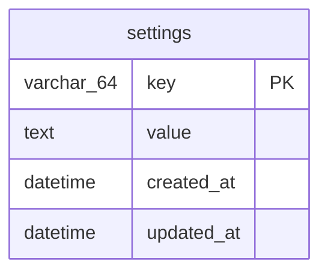

# Data Model

Tables and columns that exist now, with a Mermaid erDiagram of the current schema.

Source of truth: `server/prisma/schema.prisma`. Migrations: `server/prisma/migrations` (created with `prisma migrate dev`, never by hand).

## settings

Key and value pairs (blueprint 4.5). No relationships and no foreign keys.

| Column | Type | Notes |
| --- | --- | --- |
| key | VARCHAR(64), primary key | Setting name |
| value | TEXT, not null | Always a string. Numbers such as the rate are stored as text and read as Decimal where they are used (P5) |
| created_at | DATETIME(3) | Default now |
| updated_at | DATETIME(3) | Set by Prisma on every update |

Seeded defaults (`npm run db:seed`, idempotent; an existing value is never overwritten):

| key | value |
| --- | --- |
| perChildDailyRate | "25.00" (A-03) |
| currentSchoolYear | "2026-2027" (default; to be confirmed with the clients) |

## Sprint S1: centers, users, parent_profiles

Migration `20261106120950_auth_centers_users`.

| Table | Columns | Notes |
| --- | --- | --- |
| centers | id, name (unique), barangay, address, is_active, created_at, updated_at | 28 seeded from docs/seed-centers.md |
| users | id, role (ADMIN, TEACHER, PARENT), username (unique, stored lowercase), password_hash, full_name, mobile, center_id, status (ACTIVE, PENDING, DECLINED, DISABLED), must_change_password, failed_login_count, locked_until, token_version, last_login_at, created_at, updated_at | Index (center_id, role, status). center_id is null for the Admin |
| parent_profiles | user_id (PK), child_name, created_at, updated_at | Deleted with the user |
